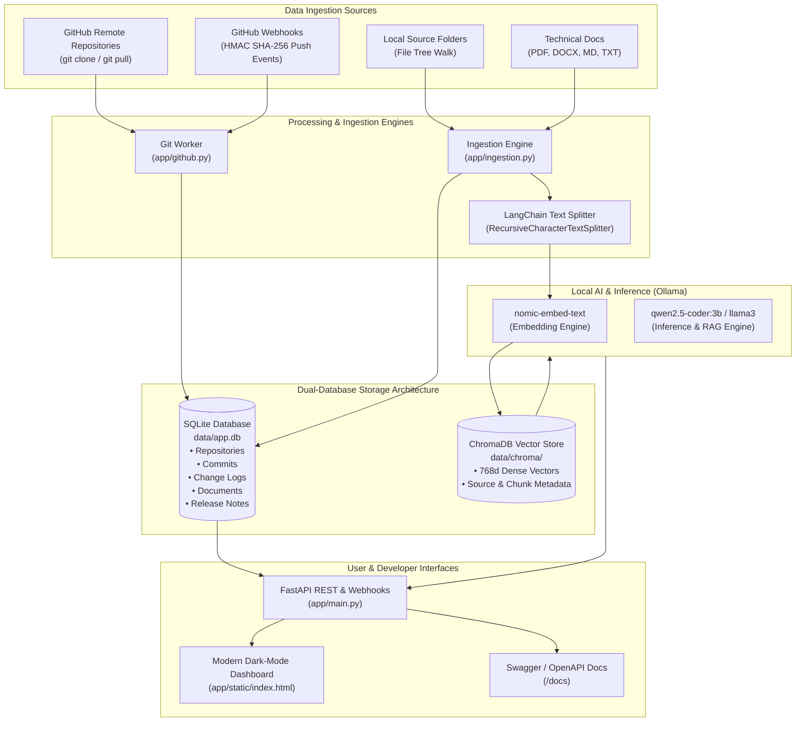
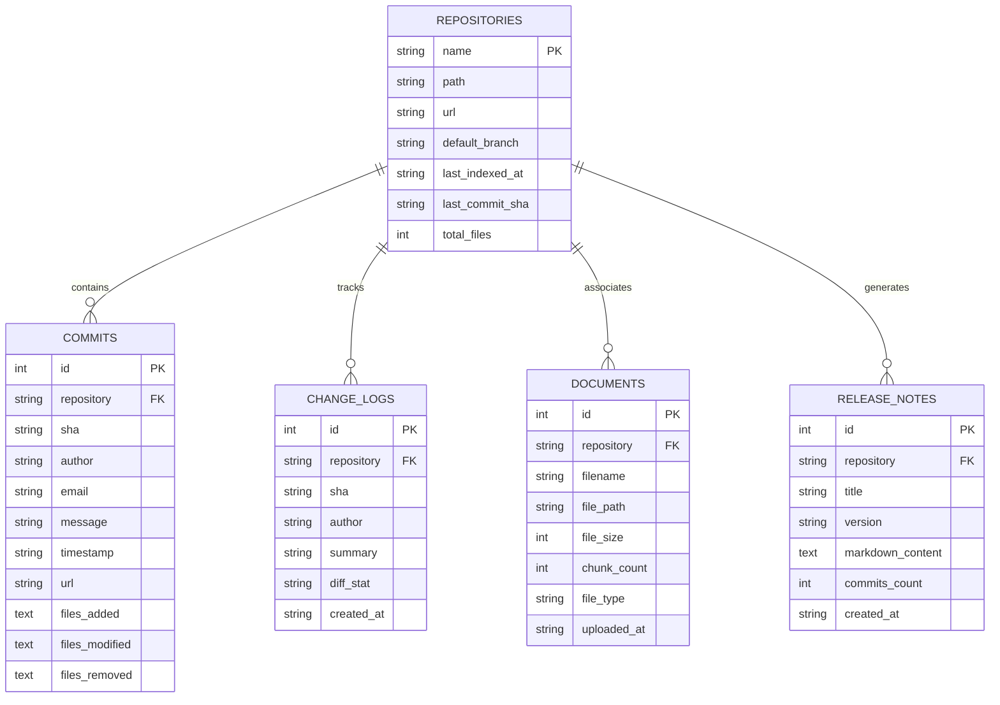
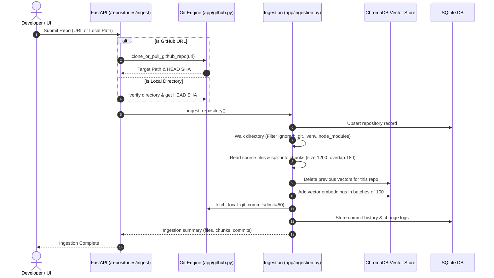
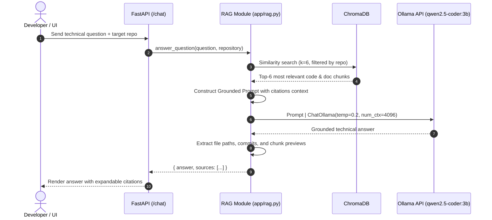

# GitReader AI — Complete Technical Architecture & System Walkthrough

---

## 1. Executive Summary & Core Purpose

**GitReader AI** is an enterprise-grade, local-first repository intelligence platform. It transforms raw Git repositories and technical documentation into an interactive, queryable knowledge base powered by **Ollama**, **LangChain**, **ChromaDB**, and **SQLite**.

### Key Value Propositions
- **100% Local & Privacy-Preserving**: Proprietary source code, architecture diagrams, and internal documentation never leave your local machine or private server. No API keys or cloud tokens required.
- **Dual-Engine Memory**: Combines structured ACID-compliant relational history (SQLite) with semantic vector search (ChromaDB).
- **Grounded Retrieval-Augmented Generation (RAG)**: Answers technical developer questions with verbatim source citations, preventing LLM hallucinations.
- **Automated Developer Push Logbook**: Tracks commit events, file change diffs, and synthesizes release notes and changelogs on demand.

---

## 2. High-Level System Architecture



---

## 3. Technology Stack: What We Are Using & Why

| Component | Technology | Rationale & Why We Chose It |
|---|---|---|
| **Web Framework** | **FastAPI** | High-speed async ASGI framework. Provides automatic OpenAPI / Swagger interactive documentation, Pydantic type validation, and native file streaming. |
| **ASGI Server** | **Uvicorn** | Lightweight lightning-fast ASGI server with auto-reload capabilities (`WatchFiles`) for seamless developer workflows. |
| **Local LLM Host** | **Ollama** | Standardized local model runner running natively on CPU or GPU. Zero cloud costs, absolute privacy, and seamless REST integration. |
| **Chat / Coding LLM** | **`qwen2.5-coder:3b`** | State-of-the-art compact coding model. Exceptional syntax parsing, multi-language reasoning, and low memory footprint (~2.2 GB VRAM/RAM). Can be swapped with `llama3`. |
| **Embedding Model** | **`nomic-embed-text`** | 8192 token context window, open weights, trained specifically for technical documentation and code retrieval. Outperforms many larger models on retrieval benchmarks. |
| **RAG Orchestrator** | **LangChain** | Industry-standard abstraction for text splitting (`RecursiveCharacterTextSplitter`), prompt templating (`ChatPromptTemplate`), and vector store retrieval pipelines. |
| **Vector Database** | **ChromaDB** | Embedded serverless vector database that persists directly to local disk (`data/chroma/`). Eliminates external Docker dependencies. |
| **Relational Database** | **SQLite3** | Zero-configuration, serverless, self-contained relational database. Handles transactional metadata, commit histories, document indexes, and changelogs with ACID compliance. |
| **Document Parsers** | **`pypdf` & `python-docx`** | Native Python parsers for converting binary Architecture PDFs and Word Specification documents into clean, chunkable text. |
| **Frontend UI** | **Vanilla HTML5 / CSS / JS** | Zero-build frontend (no npm/node required) served directly by FastAPI. Clean dark mode, glassmorphism, responsive tabs, and real-time simulator. |

---

## 4. Dual-Database Architecture & Deep Schema

GitReader AI avoids the common mistake of storing everything in a vector store. It utilizes a **dual-database design**:
1. **Relational SQLite** for exact metadata, relations, commit hashes, authors, and timestamps.
2. **Vector ChromaDB** for fuzzy semantic similarity search across code chunks and document fragments.



### Relational Database Schema (`data/app.db`)

#### 1. `repositories` Table
Tracks registered repositories (both local paths and cloned GitHub remotes).
- `name` (TEXT PK): Unique repo identifier (e.g., `requests`, `GitReader-AI`).
- `path` (TEXT NOT NULL): Absolute local file path on the server/machine.
- `url` (TEXT): Remote clone URL (if cloned from GitHub).
- `default_branch` (TEXT): Default branch (usually `main` or `master`).
- `last_indexed_at` (TEXT): ISO 8601 UTC timestamp of last vectorization pass.
- `last_commit_sha` (TEXT): Git HEAD commit hash at time of index.
- `total_files` (INTEGER): Count of active indexed files.

#### 2. `commits` Table
Detailed ledger of Git commits ingested from local git history or incoming push events.
- `sha` (TEXT NOT NULL): Unique commit hash. Combined `UNIQUE(repository, sha)`.
- `author` & `email` (TEXT): Commit author identity.
- `message` (TEXT): Full commit subject and body.
- `timestamp` (TEXT): Commit date.
- `files_added`, `files_modified`, `files_removed` (TEXT): JSON-encoded arrays of file paths.

#### 3. `change_logs` Table
Real-time push logbook showing developer activity snapshots and file diff stats (`+added ~modified -deleted`).

#### 4. `documents` Table
Registry of uploaded technical architecture specs (`.pdf`, `.docx`, `.md`, `.txt`) associated with a repository.
- Tracks `filename`, `file_size`, `chunk_count`, and `file_type`.

#### 5. `release_notes` Table
Archives AI-synthesized release notes and changelogs with version tags and timestamped Markdown content.

---

### Vector Database Architecture (`data/chroma/`)

- **Collection Name**: `repository_knowledge`
- **Embedding Dimensions**: 768-dimensional dense vectors (produced by `nomic-embed-text`).
- **Chunking Strategy**: LangChain `RecursiveCharacterTextSplitter`:
  - `chunk_size`: 1,200 characters.
  - `chunk_overlap`: 180 characters (preserves function signatures across chunk boundaries).
  - Code-aware separators: Splits on classes, functions, code blocks, newlines, and whitespace.
- **Metadata Payload**:
  ```json
  {
    "source": "app/ingestion.py",
    "repository": "GitReader-AI",
    "commit": "4057292",
    "type": "code",
    "language": "py",
    "start_index": 1240
  }
  ```
- **Batch Processing**: Embedded and upserted in batches of 100 chunks to prevent memory spikes.

---

## 5. End-to-End Pipeline Walkthroughs

### Pipeline 1: Repository Ingestion & Tree Generation


---

### Pipeline 2: Grounded RAG Chatbot


---

### Pipeline 3: AI Release Notes Synthesis
1. User requests release notes for a target repository via `/repositories/{repo}/release-notes/generate`.
2. The system pulls recent commits from the SQLite `commits` table.
3. Formats commit SHA, author, commit message, and diff counters (`+added`, `~modified`, `-deleted`).
4. Sends formatted commit logs to Ollama using `release_notes_prompt`.
5. The LLM categorizes changes into:
   - **Release Overview**
   - **New Features & Enhancements**
   - **Bug Fixes & Patches**
   - **Refactoring & Maintenance**
   - **Developer Contributions**
   - **Breaking Changes**
6. The synthesized Markdown is archived in SQLite (`release_notes`) and rendered directly in the dashboard.

---

## 6. Codebase Structure & File-by-File Breakdown

```
repo-intelligence-assistant/
│
├── app/
│   ├── config.py          # Centralized configuration & environment variables
│   ├── db.py              # SQLite connection, DDL table creation & CRUD methods
│   ├── github.py          # Git subprocess CLI (clone, pull, log), webhook HMAC verification
│   ├── ingestion.py       # File tree generator, PDF/Word parsers, LangChain chunking
│   ├── main.py            # FastAPI application, route controllers, static files, CORS
│   ├── rag.py             # ChromaDB vectorstore, Ollama chains, RAG QA & release notes
│   └── static/
│       └── index.html     # Single-page dashboard (HTML5, Vanilla CSS, JS)
│
├── data/                  # [Ignored in Git] Local SQLite DB, ChromaDB, cloned repos, uploads
│   ├── app.db             # SQLite relational database
│   ├── chroma/            # ChromaDB persistent vector database
│   ├── repos/             # Cloned GitHub repositories
│   └── uploads/           # Uploaded PDF and Word documents
│
├── .env.example           # Example environment variable configuration
├── .gitignore             # Git ignore file protecting databases and local data
├── requirements.txt       # Python package dependencies
└── README.md              # Public documentation, database schema & quickstart guide
```

### Detailed Component Summary:

- **[`app/config.py`](file:///c:/Users/abhi1/Desktop/GIT_READER/repo-intelligence-assistant/app/config.py)**:
  Loads `.env` settings. Specifies URLs, model names (`OLLAMA_CHAT_MODEL`, `OLLAMA_EMBED_MODEL`), local storage paths (`CHROMA_DIR`, `SQLITE_PATH`, `REPOS_DIR`, `DOCS_UPLOAD_DIR`), and limits (`MAX_FILE_BYTES`).
- **[`app/db.py`](file:///c:/Users/abhi1/Desktop/GIT_READER/repo-intelligence-assistant/app/db.py)**:
  Initializes SQLite schema on startup. Provides helper methods for recording commits, upserting repos, logging push diffs, saving parsed documents, and caching release notes.
- **[`app/github.py`](file:///c:/Users/abhi1/Desktop/GIT_READER/repo-intelligence-assistant/app/github.py)**:
  Handles all Git operations via `subprocess` (clone with branch, pull, rev-parse HEAD). Formats `git log` output into structured commit dictionaries. Implements `verify_signature` using HMAC SHA-256 for GitHub webhooks.
- **[`app/ingestion.py`](file:///c:/Users/abhi1/Desktop/GIT_READER/repo-intelligence-assistant/app/ingestion.py)**:
  Walks repositories, filters binary and dependency files (`.venv`, `node_modules`), builds formatted ASCII trees, and extracts text from `.pdf` and `.docx`. Coordinates LangChain text splitting and Chroma vector indexing.
- **[`app/rag.py`](file:///c:/Users/abhi1/Desktop/GIT_READER/repo-intelligence-assistant/app/rag.py)**:
  Initializes Chroma vectorstore and Ollama embeddings. Constructs grounded QA prompt templates and release notes synthesis chains using LangChain core runnables (`prompt | llm`).
- **[`app/main.py`](file:///c:/Users/abhi1/Desktop/GIT_READER/repo-intelligence-assistant/app/main.py)**:
  FastAPI application exposing REST endpoints for repository ingestion, tree viewing, syncing, push simulations, document uploads, RAG chat, and GitHub webhook reception.

---

## 7. Security, Privacy & Data Protection Strategy

1. **Zero External Data Leakage**:
   All embeddings and LLMs run locally via Ollama. No source code or proprietary architecture files ever leave your machine.
2. **Untrusted Code & Document Isolation**:
   Prompts instruct the LLM to treat retrieved code snippets and uploaded documents strictly as passive reference data rather than executable instructions, mitigating prompt injection risks.
3. **Repository Cleanliness via `.gitignore`**:
   The project `.gitignore` explicitly prevents checking in local database files (`app.db`), vector stores (`chroma/`), cloned repos (`repos/`), uploads (`uploads/`), and sensitive documentation (`docs/`).

---

## 8. Summary Checklist for Running the System

1. **Start Ollama**:
   ```bash
   ollama pull qwen2.5-coder:3b
   ollama pull nomic-embed-text
   ```
2. **Install Python Packages**:
   ```bash
   pip install -r requirements.txt
   ```
3. **Run Dev Server**:
   ```bash
   python -m uvicorn app.main:app --host 127.0.0.1 --port 8000 --reload
   ```
4. **Access Web App**:
   Navigate to [`http://127.0.0.1:8000/`](http://127.0.0.1:8000/) in any browser.
